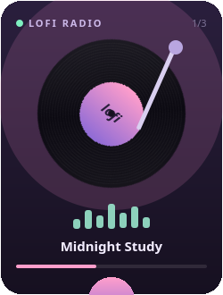

# Lofi Player — виджет для KDE Plasma 6

[](https://opensource.org/licenses/MIT)
[](https://kde.org/plasma-desktop/)
[](https://www.qt.io/)

Компактный виджет для рабочего стола KDE Plasma, который позволяет слушать lo-fi радио прямо с рабочего стола. Вращающаяся виниловая пластинка, тонарм, который поднимается при паузе, анимированный эквалайзер и живое отображение названия трека — всё это в одном виджете.



## Возможности

- **Прямая трансляция.** Воспроизведение потока с `live.lofiradio.ru` через QtMultimedia. Не требует внешнего плеера или вкладки браузера. Доступны две станции: _lofi hip hop_ (128 kbps) и _lofi chill_ (96 kbps).
- **Живые названия треков.** Icecast передаёт название песни в формате `StreamTitle='Artist - Title'`, который бэкенд FFmpeg в Qt не предоставляет. Небольшой вспомогательный скрипт на Python (только стандартная библиотека) читает метаданные из сокета и отдаёт их в формате JSON на `127.0.0.1`, чтобы виджет мог показывать текущий трек.
- **Визуализация ручной работы.** Пластинка, её бороздки и эквалайзер нарисованы кодом QML `Canvas`, а не изображениями. Ничего не нужно скачивать или настраивать.
- **Бегущая строка.** Название трека прокручивается, если не помещается в отведённое место.
- **Автопереподключение.** Если поток прерывается, виджет автоматически восстанавливает соединение. Также есть регулятор громкости.
- **Два режима.** Работает как виджет на рабочем столе (296×452) и как иконка на панели, которая отражает состояние воспроизведения.
- **Единый движок.** Потоковый движок реализован как QML _singleton_, поэтому карточка на рабочем столе, иконка на панели и всплывающее окно используют один `MediaPlayer` и одно сетевое соединение.

## Требования

| Компонент | Версия / Примечание |
| :--- | :--- |
| **KDE Plasma** | 6.0 или новее |
| **Qt** | Qt 6 с `qt6-multimedia` (бэкенд FFmpeg) |
| **Kirigami** | QML-модуль `kirigami` (устанавливается вместе с `plasma-workspace`) |
| **Python** | 3.8+ — только для вспомогательного скрипта, только стандартная библиотека, без pip-пакетов |
| **systemd** | Опционально, но рекомендуется для постоянной работы вспомогательного скрипта |

> Проверено на Arch Linux с Plasma 6.7.5, Qt 6.11 и Python 3.14.

## Установка

### Автоматическая установка (рекомендуется)

```bash
git clone https://github.com/Caracoto4/plasma-lofi-radio.git
cd plasma-lofi-radio
./install.sh
```

Скрипт устанавливает всё в домашнюю директорию, поэтому **права root не требуются**:

- `~/.local/share/plasma/plasmoids/org.koda.lofiplayer` — виджет
- `~/.local/share/lofiplayer/lofi-nowplaying.py` — вспомогательный скрипт для названий треков
- `~/.config/systemd/user/lofi-nowplaying.service` — пользовательский сервис для скрипта

После установки добавьте виджет: щёлкните правой кнопкой мыши по рабочему столу или панели → **Добавить виджеты…** → **Lofi Player**.

Если виджет не появился в списке, перезапустите оболочку:

```bash
systemctl --user restart plasma-plasmashell.service
```

### Ручная установка

Если вы предпочитаете устанавливать вручную, выполните следующие команды:

```bash
# Установка виджета
kpackagetool6 --type Plasma/Applet --install ./package

# ...или обновление уже установленного виджета
kpackagetool6 --type Plasma/Applet --upgrade ./package

# Установка вспомогательного скрипта и сервиса
install -Dm755 helper/lofi-nowplaying.py ~/.local/share/lofiplayer/lofi-nowplaying.py
install -Dm644 helper/lofi-nowplaying.service ~/.config/systemd/user/lofi-nowplaying.service
systemctl --user daemon-reload
systemctl --user enable --now lofi-nowplaying.service
```

## Удаление

```bash
./uninstall.sh
```

Экземпляр виджета, уже размещённый на рабочем столе или панели, необходимо удалить вручную: щёлкните по нему правой кнопкой мыши → **Удалить виджет**.

## Вспомогательный скрипт `lofi-nowplaying.py`

Скрипт поддерживает одно долгоживущее соединение с потоком Icecast, пропускает аудиобайты и публикует каждый блок метаданных, который видит:

```json
GET http://127.0.0.1:8731/nowplaying.json

{
  "raw": "dryhope - Shade",
  "artist": "dryhope",
  "title": "Shade",
  "station": "LoFi Radio",
  "stream": "http://live.lofiradio.ru:8000/lofi_mp3_128",
  "updated": 1792329532,
  "connected": true
}
```

Скрипт слушает только `127.0.0.1`, пытается использовать порты `8731`, `8732`, `8733` по порядку и отвечает `ok` на `GET /health`. При обрыве соединения переподключается с экспоненциальной задержкой.

Проверка статуса и логов:

```bash
systemctl --user status lofi-nowplaying
journalctl --user -u lofi-nowplaying -f
```

Виджет опрашивает скрипт каждые 2 секунды.

> **Важно:** аудио не проходит через вспомогательный скрипт. Если скрипт не работает, музыка всё равно будет играть, но без отображения названий треков.

## Структура репозитория

```text
package/                          Пакет Plasma (устанавливается через kpackagetool6)
├── metadata.json                 id, имя, версия, категория
├── contents/ui/main.qml          Апплет: полное представление + зеркало для панели
├── contents/ui/components/
│   ├── StreamPlayer.qml          QML-синглтон: MediaPlayer, станции, опрос названий
│   └── PlayerCard.qml            Визуальная карточка (независима от Plasma, загружается через qml6)

helper/
├── lofi-nowplaying.py            Метаданные Icecast -> JSON на localhost
└── lofi-nowplaying.service       Юнит systemd для пользователя

install.sh, uninstall.sh
```

`PlayerCard.qml` намеренно не импортирует ничего из Plasma, кроме Kirigami, поэтому вы можете отлаживать внешний вид с помощью обычного `qml6`, не перезапуская plasmashell.

## Решение проблем

**Нет названий треков, но музыка играет.**

Вспомогательный скрипт недоступен. Проверьте `systemctl --user status lofi-nowplaying` и `curl http://127.0.0.1:8731/nowplaying.json`. Учтите, что `lofiradio.ru` иногда транслирует джингл станции вместо названия песни; виджет показывает то, что сообщает поток.

**Ничего не воспроизводится.**

Qt 6 требует бэкенд FFmpeg для MP3-over-HTTP. Убедитесь, что установлен `qt6-multimedia` и что переменная `QT_MEDIA_BACKEND` не принудительно установлена в другое значение. Проверьте лог Plasma:

```bash
journalctl --user -u plasma-plasmashell -f
```

**Виджет отсутствует в списке «Добавить виджеты…».**

Команда `kpackagetool6 --type Plasma/Applet --list` должна показывать `org.koda.lofiplayer`. Если показывает, перезапустите plasmashell (см. выше).

**В логе вспомогательного скрипта цикл «port busy».**

Что-то другое заняло порты 8731–8733. И скрипт, и виджет перебирают одни и те же три порта, поэтому всё должно работать; если заняты все три, отредактируйте `HTTP_PORTS` и `nowPlayingPorts` в двух файлах.

## Участие в проекте

Если вы нашли ошибку или хотите предложить улучшение, создайте [Issue](https://github.com/Caracoto4/plasma-lofi-radio/issues) или отправьте Pull Request.

## Лицензия

Код распространяется под лицензией **MIT**. Подробности в файле [LICENSE](https://github.com/Caracoto4/plasma-lofi-radio/blob/main/LICENSE).

## Благодарности

- **Поток**: [lofiradio.ru](https://lofiradio.ru) — вся музыка принадлежит им.
